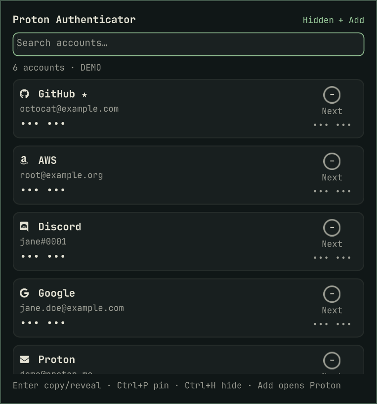

# Proton Authenticator

Proton Authenticator 2FA codes in the Omarchy Quattro bar. Search, see the
current and next code with a countdown, and click to copy. The plugin reads
the vault of the official Proton Authenticator app you already use. It needs
no root privileges, runs no background service, makes no network connections, and
doesn't replace the app.



<sub>Screenshot taken on Omarchy 4.0 with the plugin's built-in **demo mode**
(`demoMode`), which shows fake accounts and codes computed from public test
secrets. No real account or code is shown.</sub>

> Independent community plugin. Not affiliated with or endorsed by Proton AG.

## Install

```sh
omarchy plugin add https://github.com/mapski/omarchy.proton.auth.git-plugin.git --enable
```

Then install the dependencies, if you don't already have them (see
[Requirements](#requirements)):

```sh
omarchy pkg add python-cryptography python-pyotp libsecret wl-clipboard
omarchy pkg aur add proton-authenticator-bin
```

Open Proton Authenticator once and sign in or add a code. The plugin reads the
vault the app creates. Check the setup without printing any code:

```sh
~/.config/omarchy/plugins/io.github.mapski.proton-authenticator/bin/protonauth-list --check
```

## Usage

Click the key icon in the bar to open the panel, or run
`omarchy-shell shell summon io.github.mapski.proton-authenticator '{}'`.

| Action | How |
|---|---|
| Copy a code | Click its card, or `↓`/`↑` then `Enter` |
| Search | Type in the search field (issuer or account) |
| Add / edit / sync codes | **+ Add** or ⚙ opens Proton Authenticator |
| Refresh | Right-click the bar icon |
| Close | `Esc`, click outside, or `omarchy-shell shell hide io.github.mapski.proton-authenticator` |
| Next bar panel | `Tab` |

A copied code is marked sensitive and cleared from the clipboard after 20 s,
but only if the clipboard still holds that exact code. The comparison runs in
a short-lived child (`bin/protonauth-clipcheck`) that reads at most
len(code)+1 bytes of text under a timeout and never feeds clipboard data into
the long-lived shell. A code turns the theme's urgent colour in its last
5 seconds.

## Configure

```sh
omarchy bar move io.github.mapski.proton-authenticator --section right
omarchy bar set io.github.mapski.proton-authenticator clipboardClearSec 30
omarchy bar set io.github.mapski.proton-authenticator refreshIntervalSec 2
omarchy bar set io.github.mapski.proton-authenticator demoMode true --json
```

| Key | Default | Meaning |
|---|---|---|
| `refreshIntervalSec` | `1` | How often codes refresh while the panel is open (1-30 s) |
| `clipboardClearSec` | `20` | Clear a copied code after N seconds. `0` = never |
| `demoMode` | `false` | Show fake demo accounts instead of your vault (for screenshots) |

## Remove

```sh
omarchy plugin remove io.github.mapski.proton-authenticator
```

This unloads the widget, removes its bar entry and deletes the plugin folder.
The plugin keeps no other files. Proton Authenticator, its data and your
keyring are not touched. Remove the dependencies separately if nothing else
uses them.

## Update

```sh
omarchy plugin update io.github.mapski.proton-authenticator
```

## Features

- **Bar dropdown of all your TOTP codes**: issuer, account, current code
  (`123 456`), next code and a countdown ring.
- **Click or Enter to copy.** The code goes to the clipboard marked *sensitive*
  (`wl-copy --sensitive`) and is **cleared again after 20 s** if the clipboard
  still holds that exact code. The check is done by a short-lived child that
  never returns clipboard data to the shell. You can change the delay or turn
  this off.
- **Search** by issuer or account; `↑`/`↓` to move, `Enter` to copy, `Esc` to close.
- **Last-5-seconds warning.** The code switches to your theme's *urgent* colour,
  so you don't paste a code that is about to expire.
- **Works next to the official app.** `+ Add` and ⚙ open Proton
  Authenticator for adding, editing, importing and sync. The plugin never
  writes to the vault.
- **Native, theme-following icon.** It's a monochrome glyph drawn with
  `QtQuick.Shapes` in the bar foreground colour, the same way Omarchy draws its
  own Dropbox and Tailscale marks. It dims when the widget can't read codes.
- **Clear status hints** (keyring locked, missing dependency, app not set up…)
  instead of a blank panel.
- **Lightweight.** When the shell starts, the helper runs once in `--check`
  mode to set the icon state. That run returns no codes. After that, it runs
  only while the panel is open (once per second by default). Codes are dropped
  from memory when the panel closes.
- **Self-test:** `protonauth-list --check` checks dependencies, vault and
  keyring without printing a single code.

## Requirements

| What | Arch / Omarchy package | Why |
|---|---|---|
| Omarchy 4.x (Quattro shell) | `omarchy`, `quickshell` (preinstalled) | Hosts the bar widget |
| Proton Authenticator desktop app | [`proton-authenticator-bin`](https://aur.archlinux.org/packages/proton-authenticator-bin) (AUR) | Owns the vault. Set it up and sign in / add codes once |
| Python 3 | `python` (preinstalled) | Runs the helper |
| Python cryptography | `python-cryptography` | AES-GCM / HKDF to decrypt vault items |
| Python OTP library | `python-pyotp` | Computes TOTP codes |
| Secret Service client | `libsecret` (provides `secret-tool`) | Reads the vault key from your keyring |
| Wayland clipboard | `wl-clipboard` (preinstalled on Omarchy) | Copy / auto-clear |
| An unlocked keyring | `gnome-keyring` (Omarchy default) | Holds Proton's vault key |

Install anything that's missing:

```bash
omarchy pkg add python-cryptography python-pyotp libsecret wl-clipboard
omarchy pkg aur add proton-authenticator-bin
```

(`./install.sh --install-deps` does exactly this for whatever is missing.)

## Manual install, migration and scripted removal

`omarchy plugin add` is the supported install path. The repo also ships two
optional scripts for installing from a local checkout and for upgrading
pre-release builds. They're safe to re-run, support `--dry-run`, back
everything up and run entirely as your user. Run them from the repository
folder:

```sh
./install.sh --dry-run && ./install.sh     # [--section S] [--no-enable] [--install-deps] [--force]
./uninstall.sh --dry-run && ./uninstall.sh # [--purge] [--keep-legacy]
```

- `install.sh` validates with `omarchy plugin validate` and copies only the
  plugin files, staged in a fresh `mktemp -d` folder next to the target and
  renamed into place. It backs up an existing copy to a hidden
  `~/.config/omarchy/plugins/.<id>.bak-<timestamp>` folder, which Omarchy
  ignores, and places the widget through `omarchy plugin enable`.
  `--install-deps` calls `omarchy pkg add` / `omarchy pkg aur add`, which ask
  for administrator authentication themselves. If the plugin is already a git checkout from
  `omarchy plugin add`, the script defers to `omarchy plugin update`.
- **Migration.** Pre-release builds used the ids `mp.protonauth`,
  `mp.proton-authenticator-plugin` and `mapski.proton-authenticator`.
  `install.sh` puts the new widget in the old one's bar section and position,
  copies its settings (`omarchy bar set`), disables the old widget
  (`omarchy plugin disable`) and moves its folder to a hidden backup. Keybindings
  that call an old id must be updated to `io.github.mapski.proton-authenticator`.
- `uninstall.sh` removes the bar entry through Omarchy, backs up `shell.json`,
  removes the folder (or moves it to a hidden backup; `--purge` deletes backups
  too) and retires the pre-release ids. It only touches folders whose
  `manifest.json` carries the matching id and helper temp folders stamped with
  this installation's id; anything else is listed and left alone (see
  [Security](#security)).

**Why this id?** Omarchy reserves `omarchy.*` for built-in plugins, and
`omarchy plugin validate` rejects it. The develop guide's finished example uses
`io.github.<github-user>.<name>`, so the id is `io.github.mapski.proton-authenticator`. The repository name
doesn't affect the id.

## Troubleshooting

The panel's status line shows the helper's error code. Run the self-test for
details: `…/bin/protonauth-list --check`.

| Status / code | Fix |
|---|---|
| `DEPS_MISSING` | `omarchy pkg add python-cryptography python-pyotp libsecret` |
| `VAULT_UNREADABLE` | Start Proton Authenticator once and sign in or add a code, so the vault exists under `~/.local/share/me.proton.authenticator` |
| `KEY_MISSING` | The vault key isn't in the keyring (for example, a fresh login on a new machine). Open Proton Authenticator once |
| `KEYRING_LOCKED` | Unlock your login keyring (`gnome-keyring`). Normally this happens at login, so log out and back in if it's locked |
| `UNSUPPORTED_SCHEMA` | A Proton Authenticator update changed the storage format. Please open an issue with the app version (`pacman -Q proton-authenticator-bin`) |
| `DECRYPT_FAILED` | The vault and key don't match (for example, after a reinstall). Open the app, and if it works there, open an issue |
| Icon greyed out | Same as above. The icon dims whenever the helper reports an error |
| Widget missing from the bar | `omarchy plugin validate ~/.config/omarchy/plugins/io.github.mapski.proton-authenticator`, then `omarchy plugin enable io.github.mapski.proton-authenticator --section right` |
| `+ Add` doesn't open the app | Check that `/usr/bin/proton-authenticator` exists. The app starts through `uwsm-app` with `WEBKIT_DISABLE_DMABUF_RENDERER=1` |

## Security

- **Local only.** The plugin and helper make **no network connections**: no
  telemetry, update checks or analytics. Sync with your phone stays inside
  Proton's own app.
- **Read-only.** The helper opens Proton's IndexedDB with SQLite in read-only
  mode. It works on a private snapshot in a fresh `0700` `mkdtemp()` dir, deleted right
  after each run (also on errors), so it never locks or modifies the app's database.
- **Cleans up only what it created.** Nothing is ever deleted by name alone:
  - `install.sh` stages into a new `mktemp -d` folder
    (`.<id>.install.XXXXXX`) and its exit trap removes only that exact folder
    (and its own `mktemp` check folder). Pre-existing entries are never
    removed or reused, and an existing install is moved to a uniquely named
    hidden backup, never overwritten. `shell.json` is never edited by the
    scripts (changes go through `omarchy plugin enable/disable`); its backup is
    a fresh `mktemp` file next to it (`shell.json.bak-proton-auth-<ts>.XXXXXX`).
  - Pre-release folders (`mp.protonauth`, …) are only moved aside if their
    `manifest.json` carries that id.
  - On install (or first helper run) a random per-installation id is stored in
    `${XDG_STATE_HOME:-~/.local/state}/io.github.mapski.proton-authenticator/install-id`.
    Every `protonauth-idb-*` temp dir the helper creates holds a marker file
    `.io.github.mapski.proton-authenticator` with that id.
  - `uninstall.sh` removes a `protonauth-idb-*` dir only if it is a real
    directory (not a symlink) owned by you and contains a marker (regular file,
    owned by you) that matches this installation's id. It removes or moves a
    plugin folder, backup or leftover stage only if it is a real directory
    owned by you whose `manifest.json` declares the expected id. Everything
    else is listed as "left alone". `--purge` also deletes the `install-id`
    file (and its folder, only if empty).
- **How decryption works.** The vault key is Proton's per-install random key in
  your Secret Service keyring (`service=com.proton.authenticator`), read with
  `secret-tool`. Items are decrypted with AES-GCM using HKDF-SHA256, following
  Proton's published open-source Authenticator code (ProtonMail/WebClients).
  TOTP codes are computed locally with `pyotp`.
- **Seeds never reach the shell.** The helper outputs only issuer, account,
  current/next code and timing as JSON. It refuses to print a `secret` field,
  and TOTP seeds never leave the helper process. QML only ever sees codes.
- **Only while you look.** Codes are fetched only while the panel is open and
  dropped when it closes. The startup health check returns no codes. Copied
  codes are marked sensitive and auto-cleared.
- **Fixed argv, no shell.** The widget runs its own bundled helpers,
  `wl-copy` and `proton-authenticator` as fixed argument lists with no shell
  interpolation. A copied code is written to `wl-copy`'s stdin (and later to
  `bin/protonauth-clipcheck`'s stdin for the auto-clear check), never put on a
  command line (visible to other users in `ps`). Issuer/account labels are
  rendered as plain text, never as rich text/HTML. The long-lived shell never
  reads the clipboard: the clipcheck child returns only a fixed `match` /
  `nomatch` token.
- **Bounded child I/O.** Clipboard and keyring data are read with size caps
  and timeouts (`timeout`/`head -c` in clipcheck; `run_bounded` and
  `SIGALRM` in the Python helper). Helper stdout is capped and every error is
  JSON on stdout so the shell never collects unbounded stderr.
- **Fails closed.** On any error the helper prints only an error code and a
  short message (never exception text that could quote vault data), and it
  removes its temp copy on errors and on SIGTERM/SIGHUP/SIGINT.
- **Threat model.** Like Proton's own app, this trusts your Unix user. Any
  program running as you can already read the same keyring item and vault.
  Codes shown in the panel can appear in screenshots of your screen. Omarchy
  plugins run unsandboxed in `omarchy-shell`, so review the code before you
  install it. It's small: roughly 600 lines of QML/JS and 300 lines of Python.

## Why this plugin?

There are several ways to get Proton Authenticator codes onto an Omarchy
desktop. This one is built around a few specific choices:

- **Uses the official app as-is.** No patched build and no replacement package.
  Proton Authenticator keeps getting its normal updates and keeps syncing.
- **No sudo, no system changes.** The plugin is a user-level folder plus a
  Python helper. There's no system package, systemd service, socket or daemon.
  Uninstalling removes it completely.
- **No network, no build step.** It installs in seconds from plain text files
  and has no compiled binaries, so there's nothing opaque to trust.
- **Standard Arch dependencies** (`python-cryptography`, `python-pyotp`,
  `libsecret`) that you may already have.
- **Idempotent install/uninstall with dry-run and backups**, plus automatic
  migration of bar placement and settings.

The trade-off is that the helper decrypts the vault format itself. A future
Proton Authenticator release could change that format. The helper then reports
`UNSUPPORTED_SCHEMA` instead of guessing.

## Development

```sh
omarchy plugin validate .
qmllint -I "$OMARCHY_PATH/shell" BarWidget.qml Panel.qml
shellcheck install.sh uninstall.sh bin/protonauth-list bin/protonauth-clipcheck
python3 -m py_compile bin/protonauth_list.py
node --test tests/*.test.js
```

`BarWidget.qml` is the manifest entry point. It draws the icon and loads
`Panel.qml`, following Omarchy's develop guide. `assets/icon.svg` and
`ProtonAuthIcon.qml` share the same path data, so keep them in sync. Changes
are listed in [CHANGELOG.md](CHANGELOG.md).

## License

[MIT](LICENSE) © 2026 mapski. No Proton artwork or binaries are included.
